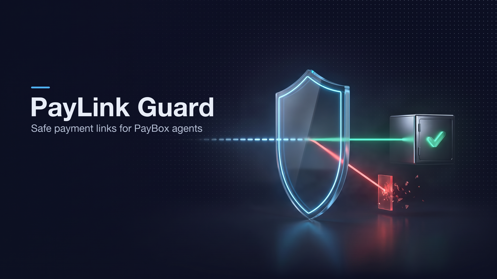
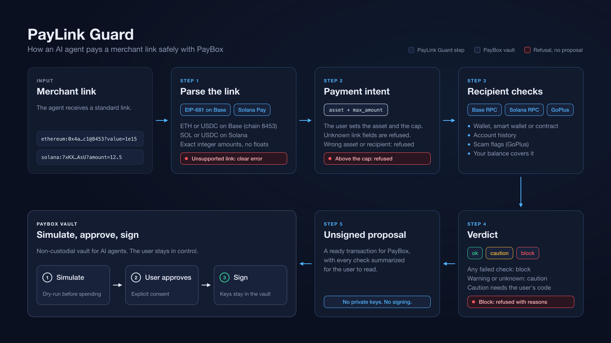

# PayLink Guard

Safe payment links for PayBox agents. A PayBox plugin for the MoonPay Hackathon (Chapter 1, Merchant tools), built by [Michael Lip](https://github.com/theluckystrike).



Merchants already ask for crypto with standard payment links: EIP-681 (`ethereum:...`) and Solana Pay (`solana:...`). An agent that receives one of these links has to answer three questions before it spends the user's money:

1. What does the link ask for: which chain, which asset, how much, and to whom?
2. Is the recipient safe? It should be a real wallet, not a token contract or a flagged address.
3. Does the payment match what the user agreed to, and can the user's wallet cover it?

PayLink Guard answers all three and then returns an unsigned PayBox transaction proposal. PayBox simulates it, the user approves it, and the vault signs it. The plugin never sees a key and never signs anything.



## Tools

| Tool | Used by | What it does | Network |
|---|---|---|---|
| `create_payment_link` | Merchant agent | Makes a standard link for USDC or ETH on Base, or USDC or SOL on Solana. The link is parsed back before it is returned. | None |
| `check_payment_link` | Payer agent | Reads a link and checks the recipient. Returns `ok`, `caution` or `block` with reasons. | Base or Solana RPC, GoPlus |
| `pay_base_link` | Payer agent | Checks the intent and the recipient, then returns an EVM proposal (ETH, or a USDC `transfer`). An optional `sender` adds a balance check. | Base RPC, GoPlus |
| `pay_solana_link` | Payer agent | Same checks plus the payer's balance, then a Solana proposal that keeps the link's `reference` keys and `memo`, so the merchant can find the payment. | Solana RPC |
| `verify_payment` | Merchant agent | Confirms on chain that the link was paid in full. On Solana the payment must carry the link's reference key. On Base, where links carry no reference, it takes the transaction hash and an optional `min_block`. | Base or Solana RPC |

## How a payment is checked

The pay tools take the user's intent as input: `asset`, `max_amount`, and optionally `expected_recipient`. Before any network call, the tool refuses a link in another asset, a link above the cap, or a link that pays someone else. This matters because a single typo in a link can change what gets paid. For example, `SPL-TOKEN=` in upper case would otherwise turn a 5 USDC invoice into a 5 SOL payment. PayLink Guard refuses unknown link parameters for the same reason.

Then the live checks run:

| Check | Chain | Result |
|---|---|---|
| Recipient is the USDC token contract, the zero address or `0x...dEaD` | Base | block (funds would be lost) |
| Recipient is a wallet, an EIP-7702 wallet, a Coinbase Smart Wallet or a Safe | Base | pass |
| Recipient is any other contract | Base | caution |
| Recipient has never sent a transaction and holds no ETH or USDC | Base | caution |
| GoPlus flags (stealing attack, sanctioned, phishing, mixer, malicious contract deployer and more) | Base | block. `blacklist_doubt` alone ("suspected") is caution. |
| Recipient is a token account or a program | Solana | block |
| Recipient is another program's data account, or a program-derived address such as a multisig vault | Solana | caution |
| Recipient account does not exist and the SOL amount is below the rent minimum | Solana | block (the transfer would fail) |
| Recipient USDC account is frozen | Solana | block |
| Payer cannot cover the amount, fees, rent and any new token account | Both | block, with both numbers |

A `block` never produces a proposal. A `caution` returns a short confirmation code together with the reasons. The agent must show the reasons to the user and call again with that code. The code is bound to the link, the amount, the reasons and a 5-minute window, and it is keyed with a value only the plugin owner sets. A merchant cannot print a valid code on an invoice, and the agent cannot reuse a code for another payment. If no recipient check can run at all (for example the network is down), the tool makes no proposal.

All amounts use exact integer arithmetic. No floating point touches money.

## Evidence

| Gate | Result |
|---|---|
| Unit tests | 253 tests, 0 failures (`pnpm unit`) |
| Starter conformance | `pnpm test` passes: type check, two identical builds, MCP sample call, 5 tools |
| NASA Power of 10 lint | no function over 60 lines, no unbounded loops, no empty catch blocks, no `eval`: 0 findings |
| Dependency audit | `pnpm audit --prod`: no known vulnerabilities. The three SPL Token instructions are written out and checked byte for byte against `@solana/spl-token`, which is only a test dependency. |
| Mainnet simulation | Solana USDC proposal with memo and reference: `err: null`, 11,354 compute units. Base USDC `transfer`: returns `true`, 45,451 gas. |
| Real recipients | 3 Safes, a Coinbase Smart Wallet and an EIP-7702 wallet on Base all pass. A known exploiter address is blocked. |
| verify_payment on mainnet | Real Base and Solana USDC transfers return `paid`. The same transfers checked against a higher amount return `mismatch`. |
| Hosted PayBox sandbox | Checks pass. The exploiter address is blocked in 3.5 s, and a Base proposal is ready in 4.0 s. An empty payer wallet gets "Your wallet has 0 USDC". |
| Independent review | Two adversarial reviews (Claude and DeepSeek) and a re-check of every fix. 20 proven findings: 19 fixed with a regression test, 1 kept on purpose (`blacklist_doubt` is caution, not block). |

## Hosted configuration

Upload `dist/plugin.mjs` only. Add these 5 network hosts: `mainnet.base.org`, `base-rpc.publicnode.com`, `solana-rpc.publicnode.com`, `api.mainnet-beta.solana.com`, `api.gopluslabs.io`. Add one variable, `PAYLINK_CONFIRM_KEY`, set to a random 64-character hex value. It keys the confirmation codes. No API keys are needed: every endpoint is public.

Each RPC call times out after 3 seconds and then tries a second provider, because the official Solana endpoint rate-limits shared IP addresses. No new attempt starts after 8 seconds. If every request hangs, a tool still answers inside the 10-second budget.

## Build

```bash
pnpm install --frozen-lockfile
pnpm unit      # unit tests
pnpm test      # type check, deterministic build, MCP conformance
node scripts/call.mjs check_payment_link '{"link":"solana:<wallet>?amount=1&spl-token=EPjFWdd5AufqSSqeM2qN1xzybapC8G4wEGGkZwyTDt1v"}'
```

Node.js 24 and pnpm 11.11.0, as PayBox starter 1.0.2 requires.

## Limits

PayLink Guard supports ETH and USDC on Base, and SOL and USDC on Solana. Other tokens and chains get a clear refusal. Interactive Solana Pay transaction requests (`solana:https://...`) are not supported. GoPlus covers EVM addresses only, so Solana recipients get on-chain checks only. Base payment links have no reference key, so `verify_payment` cannot tell two invoices to the same address apart: record each transaction hash and accept it once. ETH paid through a smart wallet cannot be traced with public RPCs and is reported as such. A pass is not a guarantee: the checks catch common and costly mistakes, and the user still approves every payment in PayBox.

## Author

Michael Lip, [github.com/theluckystrike](https://github.com/theluckystrike). MIT License.
